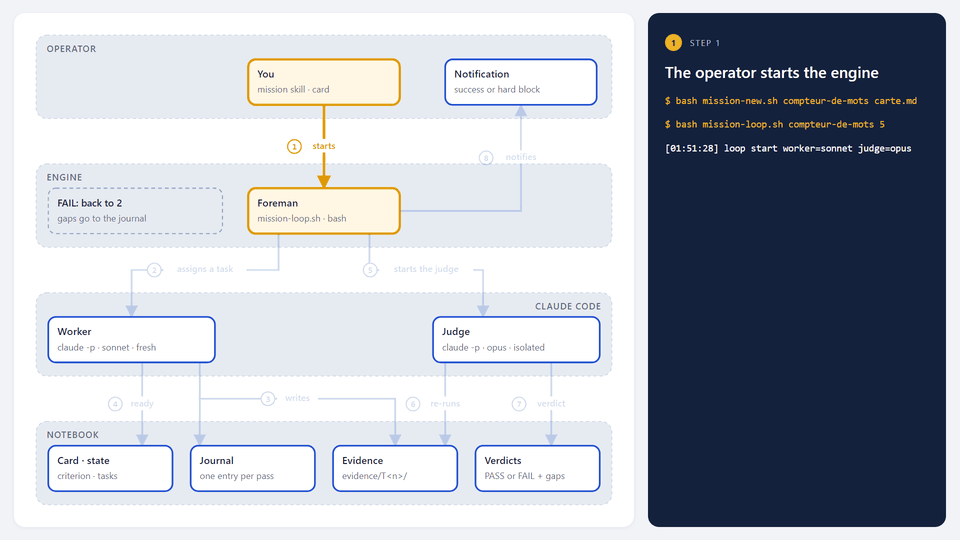
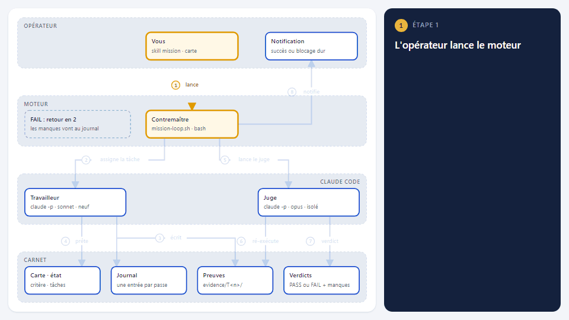

[English](README.md) · **Français**

# mission-loop

**Une boucle Claude Code qui travaille sur un but jusqu'à ce qu'un juge isolé confirme, sur les fichiers du disque, que le critère de succès écrit est atteint.**

[](https://drive.google.com/file/d/1QNLYqGIBqTZMZbCBHXdlqQtiTH245gRL/view)

<details><summary>Version française</summary>

[](https://drive.google.com/file/d/1K9-vIywi0wmYF9YfVZ9eXQWKEnrj0VwX/view)

</details>

*Une vraie passe de la carte d'exemple du dépôt : deux tâches, deux travailleurs, deux juges, 2 min 32 s. [Vidéo complète (1:27)](https://drive.google.com/file/d/1K9-vIywi0wmYF9YfVZ9eXQWKEnrj0VwX/view)*

## Utilisation

- **Écrire la carte.** Le but, le critère de succès en mots simples, les tâches avec les preuves exigées pour chacune. Le skill `mission` la rédige avec vous ; vous la validez une fois.
- **Lancer la boucle.** `mission-loop.sh` confie la prochaine tâche non finie à un travailleur `claude -p` neuf ; par défaut, une passe (travailleur ou juge) toutes les 20 minutes.
- **Les travailleurs laissent des preuves.** Chaque passe écrit une entrée au journal (hypothèse, action, observation) et des fichiers de preuve, puis annonce la tâche prête. Un travailleur ne se note jamais lui-même.
- **Un juge isolé tranche.** Lancé par le script avec un prompt adversarial fixe, il relance les preuves et écrit `VERDICT: PASS` ou `FAIL` avec les manques. Un FAIL transmet les manques au travailleur suivant.
- **Trois façons de s'arrêter.** Toutes les tâches passent, vous effacez le marqueur `.mission-active`, ou `mission-blocked` apparaît : écrit par un travailleur qui a besoin de vous (un secret, un geste physique, un jugement subjectif, une autorisation extérieure), ou par le script quand un juge n'écrit aucun verdict trois fois de suite.

## Architecture


<details><summary>Diagramme en français</summary>


</details>

## Démarrage

Les agents lancent des commandes sans demander (mode `bypassPermissions` par défaut) : un conteneur ou une machine jetable, jamais à côté d'identifiants qu'on ne peut pas perdre.

```bash
git clone https://github.com/anthohunt/mission-loop
mkdir -p ~/.claude/skills && cp -r mission-loop/skills/mission ~/.claude/skills/
E=~/.claude/skills/mission/engine
bash $E/mission-new.sh compteur-de-mots mission-loop/exemples/carte-compteur-de-mots.md
bash $E/mission-loop.sh --dry-run compteur-de-mots   # écrit le prochain prompt, n'appelle aucun modèle
bash $E/mission-loop.sh compteur-de-mots 5           # vraie passe, un tour toutes les 5 secondes
```

<details><summary>Réglages, prérequis, vérification</summary>

- **Réglages** (variables d'environnement) : `MISSIONS_ROOT` (défaut `~/.claude/missions`), `MISSION_WORKER_MODEL` (défaut `sonnet`), `MISSION_JUDGE_MODEL` (défaut `opus`), `MISSION_PERMISSION_MODE` (défaut `bypassPermissions`), `MISSION_CLAUDE_BIN`, `MAX_TICKS`, `MISSION_NOTIFY_CMD` (appelée avec un message au succès ou au blocage dur). Nouvelle carte : `skills/mission/engine/templates/MISSION-CARD-template.md`.
- **Prérequis.** bash, `awk`, `grep`, `sed`, et [Claude Code](https://code.claude.com/docs/en/overview) connecté. Testé sous Linux avec bash 5.2 ; les chemins sont convertis par `cygpath` pour Git Bash sous Windows, non testé ici.
- **Vérification.** `bash tests/test-installation.sh` vérifie l'installation et joue une boucle complète avec un faux `claude`, sans aucun modèle.

</details>

## État

- **Depuis juillet 2026.** Écrit après qu'un agent de nuit s'est arrêté tout seul : la mémoire est passée de la conversation au dossier de la mission.
- **En usage.** Les missions plus longues de l'auteur (une page web de cours, octobre 2026) gardent le même dossier : carte, journal, preuves, verdicts.
- **Pas encore fait.** Un travailleur à la fois, un seul juge, pas de reprise après un redémarrage (lancer le script sous cron ou systemd).
- **Licences.** Code sous Apache 2.0 (`LICENSE`, `NOTICE`) ; skill, gabarits, exemple et documentation sous CC BY 4.0 (`LICENSE-docs`). Inspiré de la [boucle Ralph](https://ghuntley.com/ralph/) ; aucun code copié.

---

**Anthony Hunt** · [ingevision.cloud](https://ingevision.cloud/?p=mission-loop) · [LinkedIn](https://www.linkedin.com/in/anthony-hunt-3948a9196) · [GitHub](https://github.com/anthohunt)
