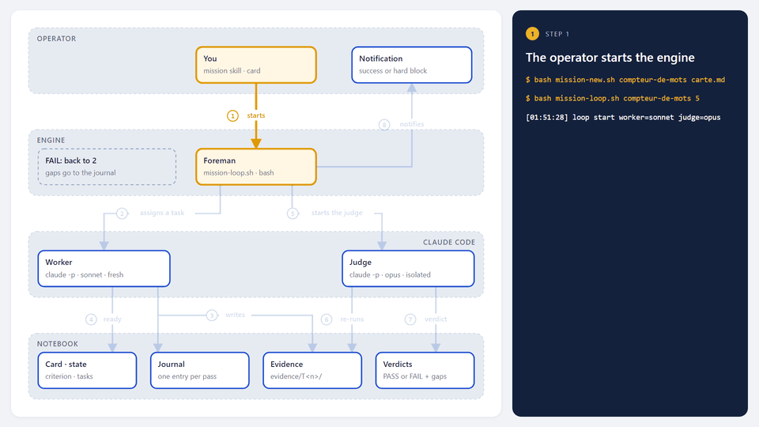
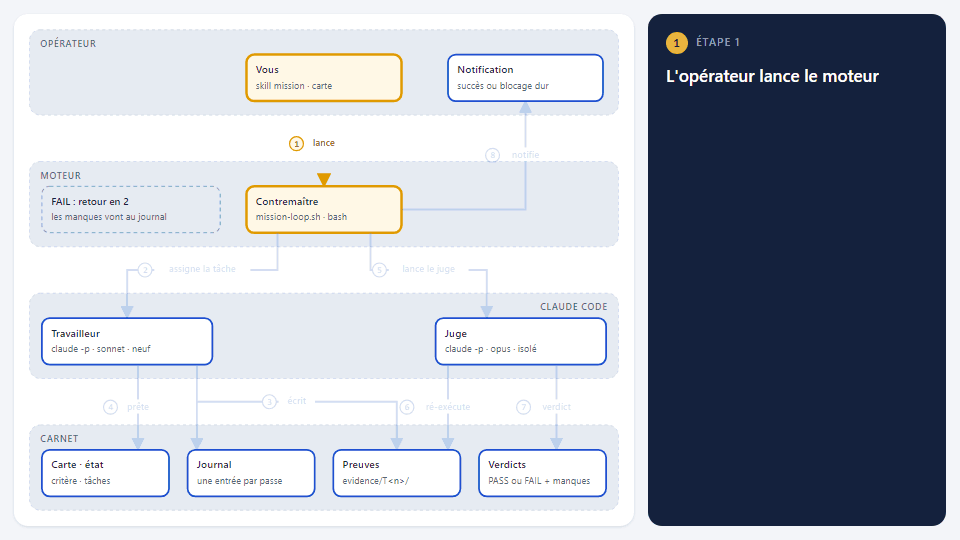

**English** · [Français](README.fr.md)

# mission-loop

**A Claude Code loop that keeps working on a goal until an isolated judge confirms, from the files on disk, that the written success criterion is met.**

[](https://drive.google.com/file/d/1QNLYqGIBqTZMZbCBHXdlqQtiTH245gRL/view)

<details><summary>French version</summary>

[](https://drive.google.com/file/d/1K9-vIywi0wmYF9YfVZ9eXQWKEnrj0VwX/view)

</details>

*A real run of the example card in this repository: two tasks, two workers, two judges, 2 min 32 s. [Full video (1:27)](https://drive.google.com/file/d/1QNLYqGIBqTZMZbCBHXdlqQtiTH245gRL/view)*

## Using it

- **Write the card.** Goal, success criterion in plain words, tasks with the proofs each one needs. The `mission` skill drafts it with you; you validate it once.
- **Start the loop.** `mission-loop.sh` hands the next unfinished task to a fresh `claude -p` worker; by default one pass (worker or judge) every 20 minutes.
- **Workers leave proofs.** Each pass writes a journal entry (hypothesis, action, observation) and evidence files, then marks the task ready. A worker never grades itself.
- **An isolated judge decides.** Started by the script with a fixed adversarial prompt, it re-runs the evidence and writes `VERDICT: PASS` or `FAIL` with gaps. A FAIL sends the gaps to the next worker.
- **Three ways to stop.** Every task passes, you delete the `.mission-active` marker, or `mission-blocked` appears: written by a worker that needs you (a secret, a physical action, a subjective call, an outside authorisation), or by the script after a judge writes no verdict three times.

## Architecture


<details><summary>French version</summary>


</details>

## Quick start

Agents run commands without asking (default `bypassPermissions` mode): use a container or a throwaway machine, never next to credentials you cannot lose. The skill, prompts and script messages are in French.

```bash
git clone https://github.com/anthohunt/mission-loop
mkdir -p ~/.claude/skills && cp -r mission-loop/skills/mission ~/.claude/skills/
E=~/.claude/skills/mission/engine
bash $E/mission-new.sh word-count mission-loop/exemples/carte-compteur-de-mots.md
bash $E/mission-loop.sh --dry-run word-count   # writes the next prompt, calls no model
bash $E/mission-loop.sh word-count 5           # real run, one pass every 5 seconds
```

<details><summary>Settings, requirements, check</summary>

- **Settings** (environment): `MISSIONS_ROOT` (default `~/.claude/missions`), `MISSION_WORKER_MODEL` (default `sonnet`), `MISSION_JUDGE_MODEL` (default `opus`), `MISSION_PERMISSION_MODE` (default `bypassPermissions`), `MISSION_CLAUDE_BIN`, `MAX_TICKS`, `MISSION_NOTIFY_CMD` (called with a message on success or hard block). New card: `skills/mission/engine/templates/MISSION-CARD-template.md`.
- **Requirements.** bash, `awk`, `grep`, `sed`, and [Claude Code](https://code.claude.com/docs/en/overview) logged in. Tested on Linux with bash 5.2; paths are converted with `cygpath` for Git Bash on Windows, untested here.
- **Check.** `bash tests/test-installation.sh` checks the install and plays a full loop with a fake `claude`, without any model.

</details>

## Status

- **Since July 2026.** Written after an overnight agent stopped on its own: the memory moved out of the conversation into the mission folder.
- **In use.** The author's longer missions (a course web page, October 2026) keep the same folder: card, journal, evidence, verdicts.
- **Not built yet.** One worker at a time, a single judge, no restart after a reboot (run the script under cron or systemd).
- **Licences.** Code under Apache 2.0 (`LICENSE`, `NOTICE`); skill, templates, example and documentation under CC BY 4.0 (`LICENSE-docs`). Inspired by the [Ralph loop](https://ghuntley.com/ralph/); no code copied.

---

**Anthony Hunt** · [ingevision.cloud](https://ingevision.cloud/?lang=en&p=mission-loop) · [LinkedIn](https://www.linkedin.com/in/anthony-hunt-3948a9196) · [GitHub](https://github.com/anthohunt)
